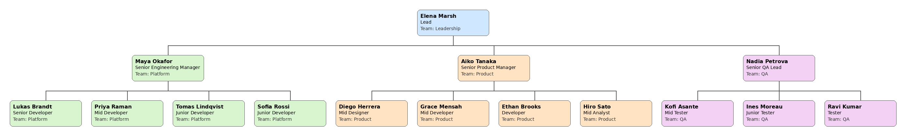

# CTOrg

Draw an org chart from a JSON file, in the terminal, as PNG, or as SVG. You can also list people and print counts.



## Install

    pip install -r requirements.txt

Requires Python 3 with `click`, `Pillow` and `svgwrite`. `pytest` is only needed to run the tests.

## Data

The data is a JSON array of people:

```json
[
  { "name": "Elena Marsh", "role": "Lead", "team": "Leadership", "manager": null },
  { "name": "Maya Okafor", "role": "Engineering Manager", "seniority": "Senior", "team": "Platform", "manager": "Elena Marsh" }
]
```

| Field       | Required | Notes                                                        |
|-------------|----------|--------------------------------------------------------------|
| `name`      | yes      | Unique. Managers refer to people by this value.              |
| `role`      | yes      | Free text, e.g. `Developer`, `Tester`.                       |
| `seniority` | no       | One of `Junior`, `Mid`, `Senior`.                            |
| `team`      | no       | Free text. Used for colors and filters.                      |
| `manager`   | no       | A `name` from the file. Omit or set to `null` for the top.   |

The loader rejects duplicate names, unknown managers, invalid seniority, and manager cycles. See `data.json` for a full example.

## Usage

Draw the chart. The bare form is the same as `chart`:

    python ctorg.py chart [data.json] [--format {ascii,png,svg}] [-o OUTPUT]

| Format    | Result                                                      |
|-----------|-------------------------------------------------------------|
| `ascii`   | Printed to the terminal (default). Colored by team on a TTY unless `NO_COLOR` is set. |
| `png`     | Image, `orgchart.png` by default.                          |
| `svg`     | Vector image, `orgchart.svg` by default.                   |

`-o` sets the output path. With `ascii`, it writes plain text to that file instead of printing.

    $ python ctorg.py
    Elena Marsh — Lead (Leadership)
    ├── Maya Okafor — Senior Engineering Manager (Platform)
    │   ├── Lukas Brandt — Senior Developer (Platform)
    │   ├── Priya Raman — Mid Developer (Platform)
    │   ├── Tomas Lindqvist — Junior Developer (Platform)
    │   └── Sofia Rossi — Junior Developer (Platform)
    ├── Aiko Tanaka — Senior Product Manager (Product)
    │   ├── Diego Herrera — Mid Designer (Product)
    │   ├── Grace Mensah — Mid Developer (Product)
    │   ├── Ethan Brooks — Developer (Product)
    │   └── Hiro Sato — Mid Analyst (Product)
    └── Nadia Petrova — Senior QA Lead (QA)
        ├── Kofi Asante — Mid Tester (QA)
        ├── Ines Moreau — Junior Tester (QA)
        └── Ravi Kumar — Tester (QA)

### List people

    python ctorg.py list [data.json] [--role ROLE] [--seniority {Junior,Mid,Senior}] [--team TEAM]

Prints one line per person, in file order. Filters combine: a person must match all of them. `--role` and `--team` are case-insensitive.

### Stats

    python ctorg.py stats [data.json]

Prints the number of people, top-level people, levels, managers, and span of control (average and maximum direct reports). It also prints counts by team, seniority, and role.

`list` and `stats` write no files.

## Tests

    pytest

## License

Apache License 2.0. See `LICENSE`.
